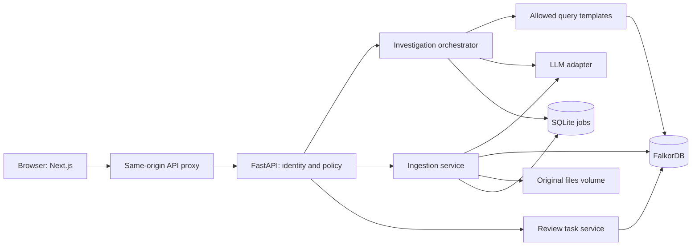

# Company Brain — Architecture and Contracts

Version: 1.0 · Prepared: 15 October 2026 · Architecture baseline; local implementation is present. See Memory.md for implemented differences and verification.

## 1. Architecture decisions

Use Next.js with TypeScript for the browser application, FastAPI/Pydantic for the API and agent services, the official FalkorDB Python client for graph operations, SQLite for operational jobs and private sessions, and local volume storage for uploaded originals. Use CSS variables and CSS Modules for styling and React Flow for the focused answer graph. Choose one available LLM provider through a small adapter; the provider and model ID are configuration, not assumptions embedded in business logic.

Pin supported stable versions during IP-01. Verify the concrete client APIs against that pinned version. Baseline references: [Next.js](https://nextjs.org/docs/app/getting-started), [FastAPI](https://fastapi.tiangolo.com/tutorial/), [Pydantic](https://docs.pydantic.dev/latest/concepts/models/), [React Flow](https://reactflow.dev/learn), [FalkorDB Python client](https://github.com/FalkorDB/falkordb-py).

FalkorDB owns all business entities, claims, provenance, current source pointers, and review tasks. SQLite never becomes an alternate company knowledge database. Build directly on the client for this MVP so claim lifecycle and permission behavior remain explicit. GraphRAG-SDK, Graphiti, vector search, and multi-agent frameworks are optional future integrations, not required dependencies.

## 2. Component map



Run one API worker in P0. Its ingestion runner uses a durable job table and a single in-process write lock. Network reads can remain concurrent. Any additional worker/process requires replacing this lock with shared coordination; do not scale process count silently. Database and file volumes survive container replacement. The database port is private to the compose network in the deployed demo.

## 3. Repository layout to create

```text
company-brain/
  docs/                         # Copy this seven-document specification here
  apps/web/
    app/                        # Investigate, sources, reviews, history routes
    components/                 # Answer, evidence, graph, source and task UI
    lib/api/                    # Generated types + typed fetch client
    styles/tokens.css
  services/api/
    app/main.py
    app/config.py
    app/api/                    # Route handlers only
    app/auth/                   # Sessions, groups, capabilities
    app/domain/                 # Pydantic models and predicate registry
    app/graph/                  # Repository, query files, eligibility filters
    app/ingestion/              # Adapters, chunker, extractor, validator, runner
    app/agent/                  # Planner, tools, synthesizer, evidence checks
    app/reasoning/              # Risks, conflicts, impact, answer diff
    app/memory/                 # Operational store and private sessions
    app/reviews/                # Proposal and confirmation
    app/prompts/               # Versioned extraction/planning/answer prompts
    tests/unit/
    tests/integration/
  fixtures/orbit-labs/           # Sources, registry, revisions, expected facts
  evals/                        # Questions, scoring, results, baseline runner
  tests/e2e/
  scripts/                      # Seed, safe reset, check, evaluate
  infra/                        # Containers and database config
  compose.yaml
  .env.example
  README.md
```

## 4. Canonical graph schema

One graph per organization, selected using a server-owned map: `org_id → graph_name`. Do not accept arbitrary graph names from clients. The MVP graph can be `company_brain_orbit_demo`.

### Nodes

| Label | Required properties | Meaning |
|---|---|---|
| GraphMeta | id, schema_version, epoch | Singleton; epoch increases after every active mutation |
| Entity | id, kind, canonical_key | Stable business identity; kind is an enum |
| Source | id, kind, active_revision_id, acl_groups, state | Logical record and current access policy |
| SourceRevision | id, source_id, revision_number, checksum, source_updated_at_ms, indexed_at_ms, state, title, content_path, ingestion_mode | Immutable content version; state: staging/active/historical/failed; mode: fixture/live_import |
| Chunk | id, revision_id, ordinal, text, char_start, char_end | Exact evidence text in normalized source body |
| Claim | id, predicate, scope, scalar_json, valid_from_ms, valid_to_ms, extraction_method, extraction_score, review_state | One source-supported assertion |
| ReviewTask | id, title, reason, assignee_id, created_by, created_at_ms, state, idempotency_key, evidence_ids_json | Confirmed internal work item |

`Entity.kind`: Person, Team, Project, Service, Customer, Ticket, Decision, Commitment. The small registry contains explicitly shared directory entities. Public directory labels/aliases are kept in the registry file and mirrored as Entity properties only when the directory declares them organization-visible. For private record entities, use opaque IDs and obtain titles from accessible source revisions. Never promote a private extracted name or alias to the shared registry automatically. Unknown names become unresolved ingestion candidates, not silently merged entities.

`Source.kind`: directory, document, chat, ticket, decision. `Source.state`: active, withdrawn. `Claim.review_state`: accepted, pending, rejected. Accepted means it passed the ingestion rules; `extraction_method` distinguishes structured, model, and human evidence. It does not imply a human verified every model extraction.

Use UUIDs or deterministic hashes for application IDs. Source ID is stable across revisions. Revision identity includes source ID, normalized content checksum, metadata checksum, and monotonic revision number. Claim identity hashes revision ID, subject, predicate, object/scalar, scope, and evidence span. Store nested values as JSON strings where graph scalar properties are required; validate and decode them into typed models at the repository boundary.

An evidence ID is `ev_` followed by the deterministic hash of claim ID + chunk ID + span. It resolves through the graph, never through an unchecked filesystem path. Offsets are zero-based Unicode code-point offsets with an exclusive end: Chunk offsets address the normalized source body; SUPPORTED_BY offsets address Chunk.text. Python string slicing follows this convention; the browser must convert with `Array.from(text)` or use the returned quote to avoid UTF-16/emoji highlighting errors.

### Physical graph relationships

```text
(Source)-[:HAS_REVISION]->(SourceRevision)
(SourceRevision)-[:HAS_CHUNK]->(Chunk)
(Claim)-[:SUBJECT]->(Entity)
(Claim)-[:OBJECT]->(Entity)                 # Entity-valued assertion only
(Claim)-[:SUPPORTED_BY {start,end}]->(Chunk)
(ReviewTask)-[:ABOUT]->(Entity)
(ReviewTask)-[:ASSIGNED_TO]->(Entity)        # Person only
```

Each accepted Claim has one subject, exactly one object or scalar, and exactly one supporting chunk. Store independent supporting passages as separate claims. Group equivalent claims at read time after authorization. This prevents a merged claim from accidentally combining public and private evidence.

### Allowed business predicates

| Predicate | Subject → object/value | Cardinality within a scope |
|---|---|---|
| USES | Project → Service | Many |
| DEPENDS_ON | Service → Service | Many |
| BLOCKS | Ticket → Service or Project | Many |
| REQUIRES | Commitment → Project | Many |
| MADE_TO | Commitment → Customer | Many |
| OWNED_BY | Service or Project → Person or Team | Single primary owner |
| MEMBER_OF | Person → Team | Many |
| WORKED_ON | Person → Service, Project, or Ticket | Many; evidence of contribution |
| ABOUT | Decision → Project or Service | Many |
| STATUS | Ticket → open/in_progress/blocked/done/cancelled | Single |
| DUE_ON | Commitment → YYYY-MM-DD | Single |

For OWNED_BY, `scope=primary` is the MVP convention. Do not infer that two teams are contradictory if the evidence explicitly identifies different ownership scopes. Keep such scopes separate. Decision rationale remains cited text in its source; do not fabricate a causal relation that the source does not assert.

### Logical graph projection

The UI sees `Project --USES--> Service`, but storage is `Claim → SUBJECT(Project)` and `Claim → OBJECT(Service)`. A logical edge contains `claim_ids[]` and `evidence_ids[]`. This reified claim model is the authority for provenance, conflicts, and permissions. Never add an unfiltered direct-edge graph as a competing truth source.

Index Entity.id, Source.id, SourceRevision.id, Chunk.id, Claim.id and Claim.predicate using the supported syntax of the pinned server. Full-text indexing is optional at first; a bounded scan over authorized chunks is adequate for this small corpus. FalkorDB supports parameterized Cypher and several index types; consult the exact server reference before adding an index. [Cypher reference](https://docs.falkordb.com/cypher/)

## 5. Source and extraction contract

JSON envelope example; all IDs below are illustrative:

```json
{
  "schema_version": "1.0",
  "source_id": "ticket:T-42",
  "kind": "ticket",
  "title": "Directory Sync validation",
  "source_updated_at": "2026-10-15T03:30:00Z",
  "acl_groups": ["engineering"],
  "body": "T-42 blocks Directory Sync. Status: blocked.",
  "records": {
    "entity_id": "ticket:T-42",
    "status": "blocked",
    "blocks": ["service:directory-sync"]
  },
  "external_url": null
}
```

The trusted ticket adapter converts structured fields into claims and constructs normalized body text containing those exact field values. A client cannot smuggle arbitrary accepted graph claims through `records`: validate the adapter schema and its allowed mappings. Other envelopes supply body text for extraction. For Markdown/plain-text uploads the operator supplies source ID, title, source type, updated time, and an allowed ACL group selection in the import form. Existing source updates require the previous revision ID to prevent lost updates.

Bundled seed imports may use manually reviewed extraction artifacts matched to exact source checksums. This path is server/operator-only, sets `ingestion_mode=fixture` and `extraction_method=structured`, and passes the same evidence/type validators. Public imports cannot request fixture mode or supply accepted claims. New text imports use live extraction and set `ingestion_mode=live_import`. Fixture artifacts contain source assertions, never canned answers or question routing rules.

Limits: 2 MB per file, 20 files per job, 100,000 normalized characters per source, UTF-8, no archives/PDF/OCR in P0. Normalize line endings before storing and calculating offsets; keep the original file separately. Chunk by paragraphs and chat message boundaries, approximately 1,500 characters, at most 2,500 characters each. Include 150 characters of overlap only for long prose. Deduplicate claims by source-relative evidence span. A critical passage must not be split without enough overlap for its meaning to remain intact.

Extraction returns strict JSON: entities referenced by known ID, predicate, object ID or typed scalar, scope, quote, chunk ID, quote offsets, optional explicit validity interval, extraction score, and unresolved mentions. Validate quote equality against the chunk, predicate/type compatibility, and entity existence. Reject unsupported propositions and invalid spans. Scores below 0.85 enter pending review and do not enter normal factual answers. The threshold is a heuristic, not a truth probability. Unknown entity names also remain pending; P0 displays them and allows reimport after a deliberate registry update.

## 6. Ingestion and update lifecycle

1. Authenticate operator capability; check source update permission, expected revision, size, and MIME/encoding.
2. Store normalized original by checksum; create durable job in SQLite.
3. Parse/chunk/extract/validate outside the graph write lock. Save extraction artifacts so retries need not repeat successful model calls.
4. Under the write lock, recheck expected revision and stage immutable revision/chunks/claims using idempotent MERGE queries.
5. Validate graph counts and references for the staged revision. Staged claims are invisible to investigation queries.
6. Activate by setting Source.active_revision_id and revision states and incrementing GraphMeta.epoch in one reviewed mutation query. Use a conditional old-revision match and check affected rows; a stale update returns 409.
7. Mark the job complete, invalidate eligible-source/search caches, and expose the updated source state.

The graph's pointer is the authority if the process crashes between activation and SQLite completion. On startup, inspect incomplete jobs, reconcile their target revisions, and resume or mark completed. Old active revision remains usable when staging or extraction fails. Reupload of identical content and metadata returns the existing revision without increasing counts or epoch. A metadata/ACL-only change is still a meaningful update.

All graph writes, including ACL changes, ReviewTask creation, and resets, serialize through the same process lock. Release the lock before model calls. A source ACL restriction takes effect immediately with an epoch increment even if a content refresh is pending. Permission checks on revision history use the current Source policy.

## 7. Time, freshness, and conflict rules

Store source update time and index time separately. Claim valid_from/to describes business validity only when supplied by explicit evidence; null means unknown/unbounded, not an invented date. Source update time does not automatically become a business effective date. A current claim must belong to the active source revision, be accepted, and not have an explicit validity interval excluding the scenario time.

P0 supports current-state questions and source/answer history. Arbitrary “what did we know on date X?” queries are P1 because complete business and observation-time reconstruction needs additional policy. Never pretend that displaying an old source revision implements full temporal querying.

Freshness defaults: tickets/chats 7 days; documents/directory 30 days; decisions 90 days. Staleness is computed from source_updated_at against the configured clock and presented as a warning. It does not delete a claim or decide a conflict.

Conflict detection: group accessible current accepted claims by subject + single-valued predicate + scope. If distinct values overlap in known validity, or either interval is unknown, label a potential conflict. Multi-valued predicates do not conflict merely because values differ. Identical assertions from different sources are corroborating evidence, not independent certainty scores. Conflict resolution editing is P1; P0 creates a review task.

## 8. Identity and permission model

Server configuration defines three demo identities: Engineer = all_employees + engineering; Lead = all_employees + engineering + leadership; Viewer = all_employees. All three can ask questions and maintain their private investigation sessions. Engineer and Lead can create reviews; only Lead can import/update sources. Viewer cannot mutate company data or tasks. Creating a private question/run record does not grant business write access. A private operator credential is needed for fixture reset.

The server issues a signed HttpOnly session cookie. In DEMO_MODE the persona selector is intentionally available against synthetic data; display this limitation. Production identity is out of scope. The proxy forwards cookies to the API and disables caching for authenticated responses. State-changing requests require same-origin/CSRF protection and cannot take capability or group overrides from the request body.

A source is visible when its ACL group set intersects session groups. An empty ACL denies access. Calculate allowed source IDs and graph epoch at investigation start. Every retrieval template must filter all supporting sources to that list before returning text or relationship facts to the orchestrator. Never send forbidden chunks to the model and rely on output redaction. Search and suggestions follow the same rule.

For a citation/source/task/answer lookup, re-evaluate access. A task referencing several sources is visible only if all its supporting sources remain visible. If stored answer evidence is no longer permitted, return `needs_refresh` with no previous answer body and offer rerun. Do not reveal which hidden source caused the change. Directory labels must follow the explicit shared registry policy in section 4.

## 9. Query and agent execution

Supported intents: release_risk, change_impact, owner_lookup, decision_lookup, evidence_search. Resolve an explicit entity ID or unambiguous permitted alias. If multiple candidates match, return clarification candidates before investigating. A follow-up may use the private session's last permitted project ID, but retrieves all facts again.

Allowed tools:

| Tool | Inputs | Output |
|---|---|---|
| resolve_entity | name, optional kind | Authorized candidates |
| search_evidence | query, optional entity IDs | Ranked accessible excerpts |
| get_project_context | project_id | Uses, commitments, decisions with evidence |
| trace_dependencies | start_id, max_business_hops≤3, direction | Bounded paths and truncation indicator |
| find_blockers | project/service IDs | Tickets with current status evidence |
| find_ownership | entity_id | Claims, conflict groups, relevant contributors |

Each tool calls parameterized reviewed queries. Query text cannot be supplied by the model. The official client exposes read-only graph queries; use that path for retrieval. [Python client](https://github.com/FalkorDB/falkordb-py) and [parameterized queries](https://docs.falkordb.com/commands/graph.query).

Execution: read epoch and permitted sources → classify/resolve → validate plan → execute tools → derive deterministic findings → synthesize typed answer → validate citations and factual support → reread epoch → return and persist. If epoch changed, discard results and retry once from fresh permissions; if it changes again, return a retryable `knowledge_changed` error. This bounds the consistency guarantee to a stable graph view during each returned investigation.

Budgets: six tool calls; at most three dependency business hops; two expansion rounds after initial lookup; 150 eligible logical claims per tool; 30 graph display nodes and 50 edges; 16 evidence excerpts of at most 1,500 characters; 1,500 ms per graph query; 25 seconds per complete run. Deduplicate and track visited IDs to stop dependency cycles. Mark incomplete scope when any evidence/path limit is reached. Stage timeouts must fit the total deadline; do not allow each stage its own unlimited 25 seconds.

Graph query pattern illustration (eligibility helper must also add validity checks):

```cypher
MATCH (c:Claim)-[:SUBJECT]->(e:Entity {id:$entity_id})
MATCH (c)-[:OBJECT]->(o:Entity)
MATCH (c)-[:SUPPORTED_BY]->(ch:Chunk)
MATCH (r:SourceRevision)-[:HAS_CHUNK]->(ch)
MATCH (s:Source)-[:HAS_REVISION]->(r)
WHERE c.predicate = $predicate
  AND c.review_state = 'accepted'
  AND s.state = 'active'
  AND s.id IN $allowed_source_ids
  AND s.active_revision_id = r.id
RETURN c.id, o.id, ch.id, r.id, s.id
LIMIT 150
```

Build explicit multi-relation templates for project dependencies and commitments. Do not assume filtering just the first or last source secures intermediate steps. For the P0 corpus, traversal queries may return IDs and eligible claims for a bounded Python graph walk; FalkorDB must still supply the actual relationship set for every answer.

## 10. Deterministic findings and answer synthesis

Release risk rule: a project reaches a service through USES followed by zero to three DEPENDS_ON relations; a ticket BLOCKS that project/service; its unambiguous STATUS is open, in_progress, or blocked. Include affected commitments linked by REQUIRES and MADE_TO. A conflicting/missing ticket status is an unresolved status finding, not a confirmed blocker or resolved state.

Risk ordering: (1) confirmed blockers affecting a commitment due within three scenario days; (2) other confirmed blockers; (3) conflicting ownership/status; (4) stale or missing evidence. Categories express this rule, not a model-produced numerical probability. DUE_ON uses end of that date in Asia/Kolkata for the seeded organization; record this policy in configuration. Decision text adds supported context but cannot independently establish a blocker without a modeled rule.

Change impact is a conditional dependency statement: “If this service is unavailable, these connected projects and commitments may be affected.” Graph reachability does not prove an outage or a delivery delay. Expertise results show why someone is relevant and do not claim they are the formal owner.

The model receives only a validated evidence bundle and findings. Require output blocks with `kind=fact|inference|uncertainty`, `text`, and `evidence_ids`. Check IDs, access, revision eligibility, and nonempty evidence for factual blocks. Use deterministic templates for canonical status/path facts to reduce unsupported paraphrase. Human/model entailment evaluation still matters; an ID-valid citation alone is insufficient.

If the model is unavailable, return a deterministic supported findings view with `execution_mode=deterministic`. This remains a genuine graph result, but label it clearly. An empty findings set returns `insufficient_evidence` or a qualified “No known blockers in the indexed sources you can access,” never unconditional launch approval.

## 11. API contracts

All endpoints are under `/api/v1`. Times serialize as ISO 8601; IDs are strings. Requests/responses are Pydantic models, with frontend types generated from OpenAPI. Unknown fields are forbidden on mutation and model-output schemas.

| Method/path | Contract |
|---|---|
| GET /health/live, /health/ready | Process live; ready includes graph and operational-store checks |
| POST /demo/session | `{persona}`; DEMO_MODE only; returns session display metadata and sets cookie |
| GET /me | Current display identity, groups, capabilities, demo flag |
| POST /sessions | Create private conversation session |
| GET /sessions/{id} | Authorized session metadata and run IDs; no unvalidated answer replay |
| POST /investigations | `{session_id,question,entity_id?,previous_run_id?}`; returns `{run_id,status:"queued"}` |
| GET /investigations/{id} | Running stage or final AnswerEnvelope; user/session ownership enforced |
| GET /entities/search?q= | Authorized labels/IDs/kinds; limit 10 |
| GET /sources | Paginated authorized metadata; limit 20 by default |
| POST /imports | Multipart files + envelope metadata; Lead capability; returns job ID |
| GET /jobs/{id} | Operator-authorized ingestion status, counts, actionable errors |
| GET /sources/{id}/revisions | Current-access-checked history metadata |
| GET /evidence/{id} | Authorized excerpt, source/revision metadata, offsets, active/historical flag |
| PATCH /sources/{id}/access | Lead-only ACL update + expected revision; increments epoch |
| POST /reviews/proposals | `{run_id,entity_id,assignee_id,reason}`; preview, evidence IDs, expiry, proposal ID |
| POST /reviews/confirm | `{proposal_id,idempotency_key}`; confirms existing preview after revalidation |
| GET /reviews | Authorized internal tasks with safe evidence previews |
| POST /demo/apply-revision | Lead-only known fixture ID through normal ingestion; synthetic demo only |
| POST /demo/reset | Private operator capability; exact known demo graph only |

Client polls investigation and job status every 500–1,000 ms while visible, with a 30-second timeout for investigation UI and backoff for ingestion. P0 does not need token streaming. Stage messages come from actual execution state. Canceling client polling does not imply the server canceled the job.

AnswerEnvelope shape:

```json
{
  "run_id": "run_123",
  "status": "complete",
  "answer_state": "partial",
  "execution_mode": "live_model",
  "intent": "release_risk",
  "graph_epoch": 17,
  "generated_at": "2026-10-15T04:30:00Z",
  "scenario_time": "2026-10-15T04:30:00Z",
  "blocks": [{"kind":"fact","text":"T-42 blocks Directory Sync.","evidence_ids":["ev_1"]}],
  "findings": [{"id":"risk_T42_atlas","category":"blocker","entity_ids":["ticket:T-42","project:atlas"],"evidence_ids":["ev_1"],"path_id":"path_1"}],
  "conflicts": [],
  "evidence": [],
  "graph": {"nodes":[],"edges":[],"paths":[]},
  "scope": {"visible_sources_considered":12,"truncated":false,"warnings":[]},
  "changes": {"added":[],"removed":[],"changed":[]},
  "suggested_action": null,
  "metrics": {"duration_ms":4200,"graph_query_count":5,"model_calls":2}
}
```

This example is a contract illustration, not a complete valid result: a real response must populate all referenced evidence/path objects. `answer_state`: supported, partial, conflict, insufficient_evidence, clarification, needs_refresh. Priority when several apply: clarification → insufficient_evidence → conflict → partial → supported. `needs_refresh` is a stored-result read state after access or evidence invalidation. `status`: queued, running, complete, failed. Failed responses use the error contract rather than fabricated answer blocks.

Evidence DTO: id, claim_id, source_id, revision_id, chunk_id, quote, start, end, source_title, source_kind, source_updated_at, indexed_at, extraction_method, ingestion_mode, is_stale, is_current. Graph edge DTO: id, source_entity_id, target_entity_id, predicate, claim_ids, evidence_ids, conflict flag. Graph path DTO: id, ordered edge IDs. Scope counts cover accessible records only.

Errors: `{error:{code,message,retryable,request_id,field_errors?}}`. Use 400 malformed input; 401 no session; 403 forbidden capability; 404 missing or inaccessible object; 409 revision/proposal conflict; 413 upload limit; 422 schema validation; 429 request limit; 503 dependency unavailable. Completed asynchronous runs may carry this same typed error object. No stack traces or private source names in public errors.

## 12. Review tasks and conversation memory

Store proposals in SQLite with actor, run, evidence IDs, graph epoch, assignee, title, expiry (10 minutes), and a hash of displayed fields. Confirmation revalidates access, identity, assignee membership, evidence, and current epoch. Changed evidence returns 409 with a request to regenerate the preview. Successful creation writes a ReviewTask to FalkorDB and increments epoch. The idempotency key is unique per organization + actor + proposal. A repeated key with different content returns 409.

After authenticating and checking current task/evidence access, check for an existing successful idempotency result before validating proposal expiry/epoch for a new write. Return that same task for an identical retry. This avoids the task creation's own epoch increment invalidating its response retry. A new confirmation still rechecks epoch under the write lock immediately before mutation.

SQLite tables: users/sessions (demo auth/session ownership), conversation_context (last entity IDs, no authoritative business facts), investigation_runs (request, state, structured result, source IDs/epochs), ingestion_jobs (payload references, status, checkpoints), review_proposals (preview and expiry). Enable foreign keys and WAL; store files outside the SQLite database. Run history is private to its initiating user; cross-user conversation sharing is P1.

Change comparison uses stable finding keys such as category + ticket + project and compares their evidence/value sets. Both previous and current runs must be authorized for the same user and investigation intent/entity. Distinguish “resolved by updated status” from “not found in current accessible evidence.” Permission loss must never be explained using a restricted old fact.

## 13. Deployment, persistence, and observability

Compose services: web, api, falkordb. SQLite and uploaded files share an API persistent volume; graph has its own volume. Configure and verify RDB/AOF durability for the pinned image, including its actual data directory. A mounted directory alone does not establish a crash-durability guarantee. [FalkorDB persistence documentation](https://docs.falkordb.com/operations/durability/persistence)

Environment contract: APP_ENV, DEMO_MODE, SESSION_SECRET, OPERATOR_RESET_TOKEN, FALKORDB_HOST/PORT/PASSWORD, FALKORDB_GRAPH, SQLITE_PATH, UPLOAD_DIR, LLM_PROVIDER, LLM_MODEL, LLM_API_KEY, LLM_BASE_URL (server-configured only), DEMO_CLOCK_ISO, ALLOWED_ORIGIN, GRAPH_QUERY_TIMEOUT_MS, RUN_TIMEOUT_MS. No LLM key in client-prefixed environment variables.

Log request/run/job IDs, graph epoch, query template name, counts, timing, model ID, prompt version, token usage when provided, and safe error codes. Do not log raw company evidence by default. Separate measured graph execution time from total request latency. Cost estimates require a recorded rate source/date; otherwise record tokens without invented currency costs.

Restart recovery marks interrupted investigations retryable, reconciles ingestion activations, preserves sessions/tasks, and removes expired proposals. Never replay a pending external action; P0 has none. Provide a reset script restricted to synthetic fixtures and an explicit seed version. Keep an operator-accessible diagnostics page or CLI; database internals need not appear in the ordinary product flow.

## BrightMart dataset extension — 17 October 2026

The user requested replacement of the original small seed with a larger, easier-to-demonstrate fictional company. The active seed is now fixtures/brightmart (200 sources, 180 entities, 432 claims). For this corpus the permission-filtered snapshot cap is 2,000 claims and answer evidence cap is 32 excerpts; the earlier 150-claim per-tool, 16-model-observation-passages, six-tool, two-round, three-dependency-hop, 30-node/50-edge and timeout limits remain. Source pagination is consumed fully and entity discovery includes all 180 public directory entries. These changes supersede only the corresponding original seed/evidence-budget assumptions.
