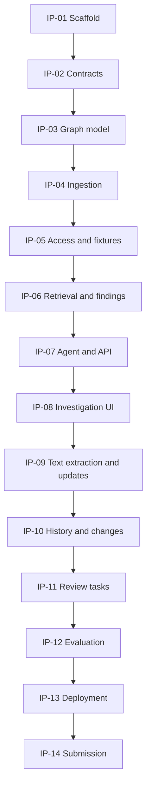

# Company Brain — Implementation Plan

Version: 1.0 · Prepared: 15 October 2026 · Planning baseline; actual task/gate status is recorded in Memory.md.

## 1. How to execute this plan

Use [PRD.md](PRD.md) for requirements, [Architecture.md](Architecture.md) for contracts, [Rules.md](Rules.md) for invariants, [Design.md](Design.md) for UI behavior, [Phases.md](Phases.md) for milestones, and [Memory.md](Memory.md) for actual state. Work in dependency order. Implement a working slice at each milestone rather than leaving integration until the end.

The paths below refer to the future implementation repository, not files that already exist. Estimates are focused task time and overlap in a team; they should not be added to infer a promised completion date. One person can own every role. No task authorizes external messaging, purchases, or deployment to an unapproved account.

## 2. Dependency map



UI shell, fixture authoring, deployment exploration, and test-case writing can proceed once contracts are stable. The numbered order is the integration dependency path, not a requirement that teammates remain idle.

## 3. Build tasks

### IP-01 — Scaffold and establish a real graph connection

Owner: infrastructure/backend · Estimate: 1–2 hours · Depends on: documentation read.

Create the repository layout, Next.js TypeScript app, FastAPI service, compose network, persistent volumes, environment example, and root task runner. Select compatible stable versions and pin them. Record image tag/digest and model choice in Memory. Configure one API worker, private database port, health endpoints, and safe development logging. Establish an actual `FalkorDB` client connection and parameterized read/write query.

Deliverables: package/lockfiles, Python dependency lock, compose.yaml, infra config, `.env.example`, `/health/live`, `/health/ready`, minimal UI.

Acceptance: services start from documented steps; readiness fails honestly when the graph is unavailable; a test record survives the configured persistence cycle. Do not claim crash durability based solely on a volume mount.

### IP-02 — Define domain, API, and provider contracts

Owner: backend/contracts · Estimate: 1–2 hours · Depends on: IP-01.

Create enums and strict Pydantic models for entities, source envelopes, claims, evidence, investigation requests/results, job status, review proposals, and errors. Create a predicate registry with allowed subject/object types and scalar validators. Define shared ID/time helpers. Generate frontend types from OpenAPI and add a generation-diff check. Implement an LLM adapter interface: `extract`, `plan`, `synthesize`; configure one real provider and a clearly labeled deterministic fallback.

Deliverables: `app/domain/`, `app/agent/provider.py`, `app/config.py`, generated web API types.

Acceptance: representative valid examples deserialize; invalid predicates, unknown mutation fields, malformed timestamps, and object-plus-scalar claims fail with field errors. Provider credentials stay server-side. The sample response in Architecture is expanded into a complete contract fixture with valid referenced evidence.

### IP-03 — Implement graph storage and eligibility

Owner: graph/backend · Estimate: 2–3 hours · Depends on: IP-02.

Implement repositories for the graph schema, GraphMeta epoch, stable ID mapping, revision staging, and source-pointer activation. Add reviewed query files and supported indexes. Create the shared eligibility builder covering source visibility, active revision, source state, claim review state, and validity intervals. Provide logical-edge DTO projection from reified claims. Add a write lock and prevent accidental multi-worker startup in demo configuration.

Deliverables: `app/graph/`, initialization command, versioned query templates, graph integration fixtures.

Acceptance: a Claim round-trips with its original evidence; inactive/pending/rejected/expired claims do not enter normal retrieval; duplicate imports preserve IDs; all graph display edges retain claim IDs. Prove these against a real FalkorDB instance, not only mocked responses.

### IP-04 — Implement durable structured ingestion

Owner: ingestion/backend · Estimate: 2–3 hours · Depends on: IP-03.

Implement source-envelope validation, normalized file storage, chunk boundaries, exact evidence span validation, deterministic adapters, durable job state, and staging/activation. Add a worker loop inside the one API process. Reconcile incomplete jobs on startup. Require expected revision on update and handle same-content no-op imports. A new revision becomes active only after its references and evidence validate.

Deliverables: `app/ingestion/`, job tables, import/job/source routes, original-file volume layout.

Acceptance: initial import succeeds; reimport is a no-op; invalid UTF-8/schema is rejected; deliberately failed staging leaves the prior revision active; process restart after graph activation but before job completion reconciles correctly. Check metadata-only updates and concurrent stale revisions.

### IP-05 — Enforce identity and load the canonical corpus

Owner: backend/data · Estimate: 2–3 hours · Depends on: IP-04.

Implement signed demo sessions, server-owned persona/group/capability maps, same-origin mutation protection, allowed source sets, and read policies for sources/evidence. Add the 24-source dataset in section 4. Curated seed extraction artifacts are permitted only for bundled content with exact recorded checksums; they go through the same evidence/type validators and graph activation as live extraction. Mark the seed method explicitly. They may encode facts, never final question/answer pairs.

Deliverables: `app/auth/`, fixtures, seed/reset scripts, permission tests, source metadata routes.

Acceptance: Engineer sees engineering and employee sources; Lead additionally sees leadership; Viewer sees employee sources only. Hiding a source removes its content and all unsupported paths, including intermediate edges. Direct-ID requests reveal no private existence. Persona change clears rendered/cached results.

### IP-06 — Implement graph tools and deterministic findings

Owner: retrieval/backend · Estimate: 3–4 hours · Depends on: IP-05.

Build entity resolution, authorized excerpt search, project context, dependency traversal, blocker lookup, ownership lookup, and decision retrieval through the tools in Architecture. Apply permission checks to every edge's evidence. Add business rules for blocker status, due commitments, potential impacts, conflicting single-valued claims, and stale sources. Generate stable finding IDs independently of model wording.

Deliverables: `app/agent/tools.py`, `app/reasoning/`, graph query templates, golden path assertions.

Acceptance: canonical project-to-blocker and commitment paths are correct; unrelated records are absent; cycles terminate; budget overflow sets partial scope; mixed status claims become uncertainty; source recency does not settle ownership. A changed fixture entity ID still works without modifying query logic.

### IP-07 — Build the bounded investigation agent and run API

Owner: agent/backend · Estimate: 2–3 hours · Depends on: IP-06.

Implement strict intent/plan output, validated tool dispatch, bounded execution, evidence bundles, answer synthesis, citation validation, and actual stage tracking. Use deterministic rendering for canonical path/status facts and model synthesis for supported context. Add durable investigation jobs and polling endpoints. Enforce graph epoch stability before returning. Limit retries and fit all stages inside the total request deadline.

Deliverables: `app/agent/`, prompts, investigation routes/store, error mapping and diagnostics.

Acceptance: paraphrased questions work; unsupported scope and ambiguous entities are explicit; a source containing “ignore instructions” cannot change tool policy; fabricated citation IDs are rejected; model outage produces labeled deterministic findings; graph outage produces an error; an epoch change causes retry, not a mixed answer.

### IP-08 — Build the real investigation UI

Owner: frontend · Estimate: 3–4 hours · Depends on: IP-07; shell can start after IP-02.

Implement AppShell, composer, entity clarification, run polling, finding/conflict cards, citations, evidence drawer, path list, and focused React Flow graph. Connect every visible count/status/control to real DTOs. Build sources list and job status for existing backend functionality. Use Design tokens and accessible dialog primitives or carefully implemented native semantics.

Deliverables: investigation route, core components, sources page, typed API client, responsive CSS.

Acceptance: user can ask, inspect a citation, trace a finding, and return to the answer using a keyboard. Graph and path list agree. Test at 1440 and 390 px. Errors and empty states preserve the user's input. Unauthorized information must not appear in the network payload even when the UI hides it.

### IP-09 — Add live text extraction and visible updates

Owner: ingestion/agent + frontend · Estimate: 3–4 hours · Depends on: IP-08.

Implement structured model extraction for Markdown/plain text, exact quote/span validation, one schema-repair attempt, pending candidates, and unresolved entities. Build import and source history UI. Implement T-42 revision fixture ingestion through the same pipeline. Add server-side capability checks for all fixture tools; no special-case answer mutation. Expose updated source times and stale-answer notices.

Deliverables: extraction prompt, extraction validator, import/history dialogs, revision fixtures.

Acceptance: a new document using existing directory entities yields cited facts without a bundled extraction artifact. A fabricated quote is rejected. The T-42 completion revision removes the blocker from new investigations. Failed extraction leaves the previous active source usable. Original and normalized content remain distinguishable.

### IP-10 — Persist session context and explain answer changes

Owner: backend + frontend · Estimate: 2–3 hours · Depends on: IP-09.

Persist conversation owner, selected entity IDs, run records, and source references. Implement follow-up context resolution with fresh retrieval. Add history, reopen/rerun, and stable finding comparison. Revalidate source access and current evidence before replay; stale runs show historical state or needs_refresh according to Architecture. Treat changed visibility separately from true business resolution.

Deliverables: `app/memory/`, changes service, history route, ChangesPanel.

Acceptance: page reload preserves the selected project and private history; another user cannot open it; a source revocation removes old answer content; T-42's actual new status explains a removed blocker; absence of current evidence does not generate a “resolved” claim. Restart marks unfinished investigations retryable.

### IP-11 — Add confirmed internal review tasks

Owner: backend + frontend · Estimate: 2–3 hours · Depends on: IP-10.

Implement proposal storage, preview, assignee validation, expiry, and confirmation. Use a server-stored proposal rather than accepting arbitrary new task body content at confirmation. Revalidate access/evidence/epoch. Look up an existing matching idempotency result after access checks but before rejecting a now-old proposal epoch, so a successful action's own epoch increment cannot break retries. Persist the task in FalkorDB.

Deliverables: `app/reviews/`, proposal/confirm/list routes, ReviewPreviewDialog, reviews page.

Acceptance: no task exists before confirmation; double-click/retry creates one task; changed request content with the same key fails; expired/changed-evidence proposals require refresh; unauthorized users cannot create or view a restricted task; restart retains it. No external system receives a write.

### IP-12 — Evaluate behavior and record honest results

Owner: evaluation/quality · Estimate: 3–4 hours · Depends on: IP-11; cases can be authored after IP-02.

Implement the 24 cases in section 5, graph integration tests, browser journey, and failure checks. Record model/prompt versions, fixture checksum, graph version, hardware, sample size, cold/warm conditions, durations, token usage, factual support judgments, and failures. Measure 30 warm runs if feasible for the latency target; report a smaller sample honestly if time restricts it.

Deliverables: `evals/questions.jsonl`, harness, timestamped JSON/Markdown report, focused unit/integration/e2e suites.

Acceptance: zero access leaks; all canonical blocker/update/idempotency gates pass; every factual block has valid citations; at least 90% human-rated factual support across the set. Treat target misses as documented outcomes requiring fixes or explicit limitation statements. Optional baseline comparison uses the same accessible sources and evidence budget, with graph traversal disabled; do not manufacture a weak baseline.

### IP-13 — Package, deploy, and rehearse recovery

Owner: infrastructure · Estimate: 2–3 hours · Depends on: IP-12.

Create production images, same-origin routing, persistent mounts, deployment instructions, startup/recovery checks, and a safe seed/reset path. Configure budgets/rate limits for demo endpoints. Ensure the public demo contains only synthetic data. Create a local deterministic fallback mode and document that live extraction requires an LLM key. Rehearse graph unavailability and model unavailability separately.

Deliverables: working deployment if available, local Docker package, smoke-check script, environment docs, operational notes.

Acceptance: a clean setup follows README without undocumented manual changes; volumes preserve records across restart; database and keys are not public; stale jobs recover; deterministic mode is labeled; graph failure does not produce canned answers. If deployment is unavailable, local instructions and video become the deliverable and the limitation is stated.

### IP-14 — Prepare submission and final handoff

Owner: demo/documentation · Estimate: 2–3 hours · Depends on: IP-13.

Record the scripted investigation/update/action journey. Show a source path and the exact changed record. Write a repository README with problem, architecture, install/run/seed steps, live versus deterministic modes, source provenance, evaluation, limitations, and reset instructions. Provide screenshots with synthetic data only. Check the actual submission form for required fields. Update all docs and Memory to reflect what shipped, including omitted P1 scope.

Deliverables: video, repository README, architecture illustration, evaluation report, application/local run reference, submission narrative. Optional blog only after required materials exist.

Acceptance: another teammate or a fresh session can reproduce the demo; all URLs/files exist; no unimplemented capability is advertised; required form materials are ready before the submission buffer.

## 4. Dataset construction specification

Create a `manifest.json` with seed version, scenario clock, source IDs, checksums, metadata, ACLs, and paths to reviewed extraction artifacts. Include every claim's expected subject/predicate/object or scalar and evidence source/span. A raw source remains readable by a human. Keep golden evaluation answers separate from ingestion artifacts and never load them into the application.

The seed command splits 24 sources into batches of at most 20 and waits for both jobs before reporting completion. Mark all seeded revisions as fixture imports. Keep the live-document demonstration outside the initial 24-source count and report the resulting count honestly.

| Source ID | Type | Required content | ACL |
|---|---|---|---|
| directory:orbit | directory | Shared entity IDs/aliases and team membership; clearly public labels | all_employees |
| doc:atlas-architecture | document | Atlas USES Auth Gateway; Auth Gateway DEPENDS_ON Directory Sync | engineering |
| doc:directory-runbook | document | Directory Sync primary owner Platform; deliberately stale timestamp | engineering |
| doc:meridian-rollout | document | C-7 REQUIRES Atlas; MADE_TO Meridian; DUE_ON 2026-10-18 | engineering |
| doc:atlas-brief | document | Project context and permitted aliases | all_employees |
| doc:beacon-overview | document | Unrelated Beacon project and dependency facts | all_employees |
| doc:leadership-note | document | Distinct fictional confidential marker and leadership context | leadership |
| chat:handoff | chat | Explicit claim that Integrations now owns Directory Sync | engineering |
| chat:directory-help | chat | Evidence that Maya and Dev worked on Directory Sync | engineering |
| chat:atlas-planning | chat | Project discussion without a new unsupported blocker | engineering |
| chat:beacon-planning | chat | Unrelated discussion for retrieval discrimination | all_employees |
| chat:ambiguous-alias | chat | Two permitted projects sharing a short alias | all_employees |
| ticket:T-42 | ticket | BLOCKS Directory Sync; STATUS blocked | engineering |
| ticket:T-43 | ticket | Done ticket affecting Auth Gateway; should not be active blocker | engineering |
| ticket:T-44 | ticket | Open unrelated Beacon blocker | all_employees |
| ticket:T-45 | ticket | In-progress unrelated service work | engineering |
| ticket:T-46 | ticket | Cancelled ticket; excluded from active blockers | engineering |
| ticket:T-47 | ticket | Completed contribution with explicit contributor evidence | engineering |
| ticket:T-48 | ticket | Unrelated service record for traversal boundaries | engineering |
| ticket:T-49 | ticket | Missing status case for uncertainty | engineering |
| decision:D-9 | decision | ABOUT Atlas; enterprise SSO requirement and no password fallback rationale | engineering |
| decision:D-10 | decision | ABOUT Auth Gateway; separate technical rationale | engineering |
| decision:D-11 | decision | ABOUT Beacon; unrelated decision | all_employees |
| decision:D-12 | decision | ABOUT Directory Sync; historical operational context | engineering |

Registry target: 3 projects, 4 services, 6 people, 3 teams, 2 customers, 8 tickets, 4 decisions, and 3 commitments. Only relationships supported in the sources become claims. It is fine for some entities to have little evidence. The names in PRD are fixed for the canonical storyline; other fictional names can be chosen during fixture authoring and then recorded.

Revision fixtures: `t42_done` changes its status and timestamp without removing its historical BLOCKS assertion; risk rules exclude it based on done status. `t42_invalid` contains a deliberately invalid evidence span and cannot activate. `restrict_runbook` changes the runbook ACL to leadership and exercises access revocation. Test each on a reset seed where appropriate; do not let one mutation contaminate unrelated evaluation cases.

For deterministic time behavior, set the initial T-42 source timestamp to `2026-10-15T03:30:00Z` and the done revision to `2026-10-15T04:25:00Z`, both before the fixed scenario clock `2026-10-15T04:30:00Z`. Actual ingestion timestamps remain real wall-clock values. The update represents newly indexed evidence of a change that already happened in the fictional scenario. Avoid future-dated validity intervals accidentally hiding the done status.

## 5. Evaluation specification: 24 cases

Golden cases record identity, initial seed/revisions, question, expected intent, expected evidence IDs/values, forbidden claims, and expected answer state. Judge factual support and required graph paths, not exact answer wording.

| ID | Class | Question / setup | Expected behavior |
|---|---|---|---|
| E01 | Direct | Engineer: status of T-42? | blocked with active ticket citation |
| E02 | Direct | Engineer: what service does Atlas use? | Auth Gateway, architecture evidence |
| E03 | Direct | Engineer: when is C-7 due? | 18 October 2026, date semantics preserved |
| E04 | Direct | Engineer: which customer is C-7 for? | Meridian Retail with MADE_TO evidence |
| E05 | Relations | What could block Atlas? | T-42 via Auth Gateway and Directory Sync |
| E06 | Relations | Which promise is affected by T-42? | C-7 and Meridian via the full joined path |
| E07 | Relations | If Directory Sync fails, what may be affected? | Conditional Atlas/C-7 impact, no asserted outage |
| E08 | Relations | Does the done T-43 block Atlas now? | Not an active blocker; status evidence |
| E09 | Relations | Does the unrelated Beacon ticket block Atlas? | No visible dependency path; qualified scope |
| E10 | Relations | Paraphrase E05 with project alias | Same necessary path, generic entity resolution |
| E11 | Ownership/decision | Who owns Directory Sync? | Platform/Integrations potential conflict |
| E12 | Ownership/decision | Who has worked on Directory Sync? | Maya/Dev with contribution evidence, no ownership inference |
| E13 | Ownership/decision | Why rule out password fallback? | D-9 rationale with precise excerpt |
| E14 | Ownership/decision | Is newer chat enough to choose the owner? | No automatic recency resolution; show both claims |
| E15 | Update | Apply t42_done, ask E05 | T-42 omitted from active blockers; qualified conclusion |
| E16 | Update | Compare E05 before/after t42_done | Removed finding explained by revised status evidence |
| E17 | Update | Apply t42_invalid, ask E01 | Prior valid state retained; failed job visible to operator |
| E18 | Update | Reimport unchanged ticket | Same current revision/counts; answer unchanged |
| E19 | Access | Viewer asks E05 | No engineering-only facts/paths; insufficient accessible evidence |
| E20 | Access | Engineer asks for leadership marker | No content/title/count disclosure; safe unavailable result |
| E21 | Access | Reopen saved owner answer after restrict_runbook | Old restricted content withheld; needs_refresh |
| E22 | Ambiguity/unknown | Ask using ambiguous shared project alias | Clarification with authorized candidates |
| E23 | Ambiguity/unknown | Ask for an absent customer contract amount | Insufficient evidence, no invented amount |
| E24 | Ambiguity/unknown | Ask who owns an entity with no owner claim | Unknown owner; relevant contributors only if supported |

Additional deterministic checks outside the 24 natural-language cases: injected source instructions; cycle/truncation; model timeout; graph timeout; fabricated citation; cross-session access; guessed evidence ID; corrupt upload; Unicode span highlighting; double confirmation; expired proposal; stale expected revision; process restart; revision activation/epoch races. These protect behavior and are not inflated into extra “accuracy questions.”

## 6. Validation commands to implement

Provide a root Makefile or equivalent task runner with these interfaces. They are desired commands, not evidence that the scripts exist today.

```sh
make dev             # Start local services with documented configuration
make seed            # Idempotent import of the known synthetic corpus
make check           # Lint, type-check, and contract-generation consistency
make test-unit       # Deterministic domain/service tests
make test-graph      # Integration checks against a disposable real graph
make test-e2e        # Browser investigation, evidence, update, review journey
make evaluate        # 24-case harness; requires configured live model for live scores
make smoke           # Health, seed availability, one supported investigation
make demo-reset      # Operator-only exact synthetic dataset reset
```

Tests use a dedicated graph name with a generated suffix and never reset the configured demo or production graph. Model tests declare live or deterministic mode in their report. Retain reproducible seeds, prompt versions, and query-template versions with evaluation results.

## 7. Requirement traceability

| Requirements | Build tasks | Primary proof |
|---|---|---|
| FR-01–03 | IP-02–05, IP-09 | Schema/import/idempotency checks; E22 |
| FR-04–06 | IP-06–08 | E01–10 and visible evidence path |
| FR-07 | IP-06–08 | E11, E14 |
| FR-08 | IP-04, IP-09–10 | E15–18 |
| FR-09 | IP-05, IP-10–11 | E19–21 plus endpoint/session access checks |
| FR-10 | IP-11 | Preview/confirm/idempotency/restart checks |
| FR-11 | IP-07–08 | E19, E22–24 and dependency-failure checks |
| FR-12 | IP-10 | Follow-up fresh retrieval, history ownership, restart |
| FR-13 | IP-04, IP-07–09, IP-12–13 | Actual job/run metrics and mode labels |

## 8. Release checklist

- Every P0 requirement has observed evidence; every missing item is disclosed.
- Canonical answer follows graph facts; a novel phrasing and changed entity ID work.
- Citations, graph edges, and exact excerpts agree.
- Conflicts remain visible; model summaries never become new canonical facts.
- Source update, failed update, and reimport behave correctly.
- Current permissions govern model context, outputs, source history, old runs, and tasks.
- Task confirmation is explicit and idempotent; no external write occurs.
- Fresh setup, persistence restart, unavailable model, and unavailable graph are rehearsed.
- Evaluation reports separate targets from measurements and fixture mode from live mode.
- Desktop/mobile layouts, keyboard evidence navigation, and real error states work.
- README, demo video, configuration example, limitations, and submission fields are complete.
- Memory reflects shipped behavior and the exact next follow-up task.
