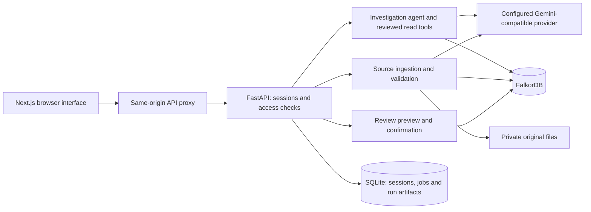

# Brian

Company Brain connects projects, people, tickets, decisions and customer commitments so you can investigate risks, trace dependencies and act on source-backed findings. The application runs locally with **Next.js**, **FastAPI**, **FalkorDB** and an optional **Gemini** API connection.

The repository includes **BrightMart**, a reproducible fictional online-retail company with 200 sources, 180 entities and 432 supported claims. You can start exploring immediately without connecting company accounts or importing your own data.

## Requirements

For the complete application:

- Docker Desktop, or Docker Engine with Docker Compose v2. Start Docker before continuing.
- Python 3, used to generate local configuration.
- `make` if using the Makefile commands. Equivalent Docker commands are provided below.
- Internet access for the first image build and for live Gemini requests.

You do **not** need to install Node.js, Python application dependencies or FalkorDB on your computer for the Docker setup.

## Quick start

Run these commands from the repository root, where `compose.yaml` lives.

### 1. Create your local configuration

```sh
python3 scripts/init_env.py
```

This creates an ignored `.env` with generated session and operator secrets. It preserves an existing `.env`. Use this script rather than copying the placeholder secrets from `.env.example`.

### 2. Configure Gemini

Open `.env` in your editor and set:

```dotenv
LLM_PROVIDER=openai-compatible
LLM_BASE_URL=https://generativelanguage.googleapis.com/v1beta/openai
LLM_MODEL=gemini-3.1-flash-lite
LLM_API_KEY=your-gemini-api-key
```

Keep the generated secrets and other defaults. The key stays on the backend; do not add it to frontend code or any `NEXT_PUBLIC_` variable.

A model key enables live question planning, agent tool selection, answer synthesis and Markdown/text extraction. Without one, the included dataset still supports clearly labeled deterministic graph investigations and structured ticket updates.

### 3. Start the application

```sh
make up
```

Without `make`:

```sh
docker compose up --build -d
```

The first build downloads dependencies and can take several minutes. Startup automatically loads missing BrightMart records; it preserves existing source revisions and does not require a separate seed command.

Open:

- **[Workspace](http://localhost:3000/investigate)** — run investigations.
- **[Workspace guide](http://localhost:3000/guide)** — browse projects, people and terminology.

Only port **3000** is exposed, on your computer's loopback interface. The API and database stay inside the Docker network. Another computer's `localhost` does not point to this installation.

## Try the main workflow

1. With the **Engineer** workspace role selected, click **Find launch risks** or ask:

   > What could block Easy Checkout, and which customer commitment is affected?

2. Open a numbered citation to inspect the exact source passage. Use the Graph tab to follow the project → system → payment dependency and its blocking ticket.
3. Ask who owns Payment Gateway. Compare the conflicting ownership records and contributors, then preview and confirm an internal review task.
4. Switch to **Lead**. In **Sources → Update ticket status**, select **T-101**, choose **Done**, and save.
5. Reopen the Lead investigation in **History** and rerun it. “What changed” explains the removed blocker using the revised status evidence.
6. You can use the same status editor to return T-101 to **Blocked**. Switch to **Viewer** to see how source access limits the findings.

Roles are local access previews: **Engineer** investigates and creates reviews, **Lead** can also import and update sources, and **Viewer** has limited source access. They are not production user authentication.

## Everyday commands

| Task | Command |
| --- | --- |
| Build and start the complete stack | `make up` |
| Start existing images without rebuilding | `make up BUILD_FLAG=--no-build` |
| Stop the stack and retain its data | `make down` |
| Resume stopped containers | `docker compose up -d` |
| Check container status | `docker compose ps` |
| Follow application logs | `docker compose logs -f api web` |
| Reload `.env` changes in the API | `docker compose up -d --force-recreate api` |
| Rebuild after changing application code | `make up` |

FalkorDB uses the `graph-data` Docker volume. Private uploads, sessions, jobs and investigation artifacts use `api-data`. Both survive ordinary restarts and `docker compose down`. **`docker compose down -v` deletes these volumes**; it is not a normal stop command.

Do not share `.env`, publish database dumps, or paste the output of `docker compose config`, which can contain resolved credentials.

## Troubleshooting

| Problem | What to do |
| --- | --- |
| Cannot connect to the Docker daemon | Start Docker Desktop or the Docker service, then run `make up` again. |
| The image registry is unavailable | If the application images were built previously, use `make up BUILD_FLAG=--no-build`. A fresh build needs registry access. |
| Port 3000 is already in use | Stop the conflicting application, or follow the alternate-port command below. |
| Gemini requests fail | Check the key, provider URL, model access and quota; recreate the API container after editing `.env`. Investigations expose their graph-only fallback. New text extraction requires a working provider. |
| The answer still reflects older source data | Rerun the investigation after the import or ticket update completes. |
| Host development uses an unexpected graph | Remove old exported `FALKORDB_*`, `SQLITE_PATH` or `UPLOAD_DIR` values from that terminal. Process environment variables take precedence over `.env`. |

To use another local port, change both the published port and the allowed browser origin:

```sh
WEB_PORT=3001 ALLOWED_ORIGIN=http://localhost:3001 docker compose up --build -d
```

Then open `http://localhost:3001`. Use the same overrides when recreating those containers. On PowerShell, set the two environment variables with `$env:NAME="value"` before running Docker Compose.

## Host development

Use this setup when editing the API or web application outside Docker. In addition to Docker, install **Python 3.12+**, **uv**, **Node.js 22+** and **npm**. The Makefile expects a Unix-like shell; Windows developers can use WSL.

Stop the container API and web app first. **Run only one API process against a graph.**

```sh
docker compose stop api web
make setup
make dev
make seed
```

`make setup` installs the locked Python and frontend dependencies. On Linux/WSL, use `make setup UV_CACHE_DIR=/tmp/company-brain-uv` to override the Makefile’s macOS cache path. `make dev` starts FalkorDB with its development port on `127.0.0.1:6389`. `make seed` imports missing fixtures without overwriting existing revisions.

Start the API and frontend in separate terminals at the repository root:

```sh
# Terminal 1
make api
```

```sh
# Terminal 2
make web
```

The web app runs at `http://localhost:3000`; the host API runs at `http://127.0.0.1:8000`. Its interactive API reference is at `http://127.0.0.1:8000/docs`.

## Checks

These commands require the host-development dependencies installed by `make setup`:

```sh
make check        # Ruff, OpenAPI/type synchronization and strict TypeScript
make build        # Production frontend build
make test-unit    # Domain and provider unit tests
make test-graph   # Real FalkorDB integration tests
make evaluate     # 24 deterministic cases and an isolated warm timing sample
make test-e2e     # Desktop/mobile browser workflows; requires Google Chrome
```

Graph checks use isolated random graphs. To expose the development database port while keeping the complete container stack running:

```sh
docker compose -f compose.yaml -f compose.dev.yaml up -d
```

Browser tests use the running local workspace. They create internal review records, update T-101 and restore its blocked status afterward; run them against the included fictional data only.

Smoke-check the complete Docker stack:

```sh
BRAIN_API_URL=http://127.0.0.1:3000 make smoke
```

`make contract` regenerates the checked-in OpenAPI and TypeScript definitions after API contract changes. Ordinary backend/evaluation tests disable paid provider calls. The optional live extraction/agent check is separate and **uses your configured API key**:

```sh
PYTHONPATH=services/api .venv/bin/python scripts/verify_live_model.py
```

Observed local checks and their limits are recorded in [Verification and limits](#verification-and-limits) below.

## Dataset and GitHub

**The BrightMart fixtures are intended to be committed with the project.** They are generated fictional records, not a real company's exports or a copy of the running database. The included names, customers, tickets and leadership-only markers are invented. Access labels exercise application filtering; they do not make these particular fictional fixtures private company information.

Commit the following with the application source:

- `fixtures/brightmart/` — source bodies, exact-span claims, registry and checksummed manifest.
- `scripts/build_fixtures.py` — the reproducible dataset generator.
- `evals/questions.jsonl` — regression questions kept separate from application facts.
- `.env.example`, `compose.yaml`, `compose.dev.yaml`, `Makefile` and the Dockerfiles.
- `apps/web/package-lock.json`, `uv.lock`, `requirements.lock` and the generated API contracts.

Regenerate the fixture files and workspace catalog with:

```sh
python3 scripts/build_fixtures.py
```

This rewrites the checked-in fixture files and workspace catalog; it also writes a readable source book when the optional `docs/` folder exists. **It does not reset an already running graph.** Startup only inserts missing sources. The [dataset explanation](#understanding-the-dataset) below describes the company story; each source JSON also contains its readable original body.

Do **not** commit `.env` or its variants, `.data/`, private uploads, local database files/dumps, dependency folders, build output, browser traces, logs or generated source bundles. `.gitignore` covers those paths, including `artifacts/` and `evals/results/`. GitHub viewers receive the fixture files and can regenerate the workspace without receiving your key or current operational history. Review new imports separately before adding them to Git.

## Project layout

```text
apps/web/                 Next.js interface and generated API types
services/api/             FastAPI, agent tools, ingestion and graph reasoning
fixtures/brightmart/      Reproducible fictional company dataset
scripts/                  Setup, seed, contract, verification and packaging tools
infra/                    Dockerfiles and database configuration
tests/e2e/                Desktop and mobile browser workflows
evals/questions.jsonl     Deterministic regression inputs
docs/                     Optional supplementary reference material
```

## Which folders can be removed?

| Path | Purpose | Can it be removed? |
| --- | --- | --- |
| `docs/` | Supplementary guides and readable source book | Yes. The maintained setup, architecture, product scope and verification summary are in this README. |
| `Architecture.md` | Original architecture specification | Yes. The implemented architecture is documented below. |
| `evals/results/` | Generated evaluation reports | Yes. `make evaluate` regenerates them. |
| `evals/questions.jsonl` | 24 regression cases for answer quality, access and updates | Optional for running the website, but keep it for `make evaluate`. Removing `evals/` disables that check. |
| `fixtures/brightmart/` | Initial company records, extraction evidence, manifest and entity directory | **Keep.** Docker builds copy it, startup seeds from it, and investigations/imports read its registry at runtime. |

“Fixtures” means prepared input data. In this project these files are the actual bundled company dataset, as well as inputs for tests. Keeping an already populated database does **not** make the folder safe to delete. Evaluation questions are separate from these company facts and are never loaded as business knowledge.

## Understanding the dataset

BrightMart is a fictional online grocery business. Its ten projects include Easy Checkout, Sales Dashboard, Delivery Tracking, Quick Refunds, Stock Alerts, Store Pickup, Customer Rewards, Seller Dashboard, Help Center and Fresh Subscriptions.

| Records | Count |
| --- | ---: |
| People / teams | 40 / 8 |
| Projects / services / customers | 10 / 16 / 10 |
| Tickets / decisions / commitments | 60 / 24 / 12 |
| Source records / supported claims | 200 / 432 |

The 200 sources comprise 94 documents, 21 chat exports, 60 ticket records, 24 decision records and one directory. A source is a document or record; an entity is something mentioned in it; a claim is one supported assertion, such as “Easy Checkout uses Checkout Service.” Some entities deliberately lack complete information so the agent can expose missing evidence.

The main story is easy to follow: **Easy Checkout → Checkout Service → Payment Gateway**. Ticket **T-101** records a payment blocker, while commitment **C-101** links the project to a promise made to Green Basket Stores for 18 October 2026. Ownership sources disagree between Payments and Integrations, and contribution records mention Maya Rao and Dev Shah. The agent connects these separate records, shows the supporting passages and surfaces the ownership conflict rather than choosing an owner without support. Completing T-101 creates a new source revision; rerunning the investigation shows the changed blocker evidence.

`registry.json` maps stable entity IDs to public names and aliases. `manifest.json` lists source files and SHA-256 checksums. Each source JSON contains an `envelope` with its readable body, source metadata and access groups, plus validated extraction `claims` with exact quotations and character positions. These are source assertions, not prewritten answers.

The bundled scenario clock is fixed at **17 October 2026, 10:00 AM IST** (`DEMO_CLOCK_ISO`). Freshness and due-date reasoning use that clock so the walkthrough is reproducible. Initially Engineer can access 196 sources, Lead 200 and Viewer 23; counts change when source permissions or imports change. Directory names are intentionally public; source passages still require access.

## Architecture



### Components and storage

- **Next.js / TypeScript** provides investigations, citations, the React Flow graph, source management, review tasks, history and workspace directories. The same-origin proxy forwards the session cookie to FastAPI.
- **FastAPI / Pydantic** validates requests, applies source permissions, runs ingestion and coordinates investigations. Python domain models define the API contract; generated OpenAPI and TypeScript types live in `apps/web/lib/api/`.
- **FalkorDB** is canonical for entities, assertions, evidence, source revisions, current source pointers and confirmed review tasks. The graph name comes from backend configuration, never a browser-supplied graph selector.
- **SQLite** holds private sessions, conversation context, durable import jobs, investigation state/results and review proposals. Saved answers are derived artifacts and are rechecked before replay.
- **Private volume storage** retains imported originals. Runtime files and databases are separate from the committed fixture files.

Run **one API worker/process per graph**. Graph mutations and access-sensitive snapshots share an in-process lock. Model requests run outside it. Adding API workers requires shared coordination; increasing the worker count alone is unsupported.

### How the agent answers

1. Authenticate the session and identify the question's intent and entity: release risk, change impact, ownership, decisions or evidence search. Ambiguous entities can require clarification.
2. Capture the current graph epoch and allowed source scope. Only permitted, accepted claims from active revisions and eligible validity intervals can enter the investigation.
3. Let the configured model choose validated read tools: `resolve_entity`, `search_evidence`, `get_project_context`, `trace_dependencies`, `find_blockers` and `find_ownership`. Tool arguments are checked, and expansion is limited to entities already observed in that investigation.
4. Build supported findings and paths from the retrieved claims. Dependency reachability indicates potential impact; it does not establish that an outage or missed delivery will happen. Conflicting ownership stays visible, and contributors are not automatically treated as formal owners.
5. Synthesize the response from permitted evidence, validate its references, and return fact/inference/uncertainty blocks, citations, graph paths, scope warnings and execution metrics. Model availability or incomplete selection can trigger an explicitly labeled deterministic fallback.
6. Save the run for history. Reruns compare stable findings and evidence with an authorized earlier run to explain additions, removals and changes.

The model cannot issue arbitrary Cypher, fetch arbitrary URLs or write company facts through investigation tools. Evidence search ranks words within accessible claims; there is no vector database or live SaaS connector. A valid citation ID proves traceability, but does not by itself prove that every model sentence is semantically correct.

| Investigation limit | Current bound |
| --- | --- |
| Tool reads / model selection rounds | 6 / 2 |
| Dependency traversal | 3 `DEPENDS_ON` hops |
| Repository snapshot / claims per tool | 2,000 / 150 |
| Source passages in tool observations / displayed answer evidence | 16 / 32 |
| Displayed graph | 30 nodes, 50 edges |
| Graph query / whole run timeout | 1,500 ms / 25,000 ms by default |
| Individual provider request timeout | Up to 10,000 ms, bounded by remaining run time |

Truncation and missing evidence affect the reported answer scope. “No known blockers in accessible indexed sources” is not unconditional launch approval.

### Graph and evidence model

Business entities have eight kinds: `Person`, `Team`, `Project`, `Service`, `Customer`, `Ticket`, `Decision` and `Commitment`. The graph also stores `GraphMeta`, `Source`, `SourceRevision`, `Chunk`, `Claim` and `ReviewTask` nodes.

```text
Source ──HAS_REVISION──> SourceRevision ──HAS_CHUNK──> Chunk
Claim  ──SUBJECT───────> Entity
Claim  ──OBJECT────────> Entity       (or a typed scalar on the claim)
Claim  ──SUPPORTED_BY──> Chunk        (exact start/end evidence span)
ReviewTask ──ABOUT─────> Entity
ReviewTask ──ASSIGNED_TO──> Person
```

Each assertion is a separate claim supported by a source passage. Claims from different sources remain independent; equivalent claims are grouped only after access checks. The UI projects those assertions as relationship edges and retains their claim/evidence IDs. Application IDs are stable hashes rather than database-internal node numbers.

| Predicates | Meaning |
| --- | --- |
| `USES`, `DEPENDS_ON` | Project systems and service dependencies |
| `BLOCKS`, `STATUS` | Ticket impact and current ticket state |
| `REQUIRES`, `MADE_TO`, `DUE_ON` | Commitment, project, customer and due date |
| `OWNED_BY`, `MEMBER_OF`, `WORKED_ON` | Ownership, team membership and contribution |
| `ABOUT` | Decision associated with a project or service |

Evidence includes source/revision/chunk IDs, exact quotation, exclusive-end character offsets, source update/index times, extraction method and current/stale flags. Offsets use Unicode code points, not JavaScript UTF-16 units. Staleness is a warning, not a rule for selecting a winner among conflicting sources. An accepted model claim has passed validators; that status does not mean a human reviewed it.

### Imports, revisions and ticket updates

Lead can upload UTF-8 Markdown, text or strict JSON source envelopes: up to **20 files per job**, **2 MB per file** and **100,000 normalized characters per source**. PDF/OCR and arbitrary external URLs are not supported. Text extraction needs the configured provider; structured ticket fields use a validated deterministic adapter. Bundled fixture claims are an operator-only ingestion path, not an accepted-claims bypass available to public uploads.

Ingestion normalizes and chunks text, extracts candidate assertions, then validates exact quotes, entity IDs, predicate/type compatibility and value formats. Low extraction scores (below 0.85) remain pending rather than entering normal answers. That threshold is a heuristic, not a probability of truth. Unknown entity names remain unresolved until a deliberate directory update/reimport.

Preparation and model calls happen outside the shared lock. Under the lock, ingestion checks the expected revision, stages immutable records, validates them and activates the new source pointer with a graph epoch increment. Failed staging leaves the old revision usable. Identical content/metadata imports are idempotent; stale concurrent edits are rejected. Durable job checkpoints support restart recovery.

The status editor handles accessible single-ticket sources and creates a human-reviewed revision without an LLM call. It preserves non-status claims, contribution evidence, pending scores and validity metadata. If evidence overlaps the status text in a way that prevents a safe edit, update the source file instead. Historical revisions remain inspectable under the source's current access policy.

### Access, history and review tasks

Role previews use signed HttpOnly session cookies. Source visibility requires an intersection between its ACL groups and the session groups; an empty ACL denies access. Mutations check capability and same-origin/CSRF requirements. Lead can import, update ticket status and change source access; Engineer and Lead can confirm internal reviews; Viewer cannot change company data.

Access filtering happens before passages reach a model. Source access, current revision eligibility and graph epoch are rechecked around investigation work and when reading saved answers, citations and tasks. Restricted evidence is not replayed from cached history; invalidated saved answers require refresh. A task's supporting sources must all remain accessible.

Review creation requires a preview followed by confirmation. The proposal records its actor, evidence, graph epoch and expiry. Confirmation revalidates it under the mutation lock and writes the canonical task to FalkorDB. Idempotency keys make identical retries return the same task. These are internal tasks; confirmation does not send email, Slack messages or Jira updates.

### API and configuration

All routes are under `/api/v1`. The checked-in `apps/web/lib/api/openapi.json` and Python models in `services/api/app/domain/models.py` are the detailed contract. In host development, browse the interactive reference at `http://127.0.0.1:8000/docs`.

| Routes | Purpose |
| --- | --- |
| `GET /health/live`, `GET /health/ready` | Liveness and dependency readiness |
| `POST /demo/session`, `GET /me` | Local workspace role sessions |
| `POST /sessions`, `GET /sessions`, `GET /sessions/{id}` | Private conversations |
| `POST /investigations`, `GET /investigations/{id}`, `GET /history` | Asynchronous question runs and history |
| `GET /entities/search`, `GET /sources` | Entity discovery and paginated permitted sources |
| `GET /sources/{id}/revisions`, `GET /evidence/{id}` | Revision metadata and exact citations |
| `POST /imports`, `GET /jobs/{id}` | Source ingestion and job progress |
| `PATCH /sources/{id}/access` | Revision-checked source ACL updates |
| `GET /sources/{id}/ticket`, `POST /sources/{id}/ticket-status` | General ticket status editor |
| `POST /reviews/proposals`, `POST /reviews/confirm`, `GET /reviews` | Preview, confirm and list internal tasks |

The backend also retains guarded fixture revision/reset compatibility routes for operator and regression use; they are not the ordinary ticket-editing workflow. Investigations expose answer state (`supported`, `partial`, `conflict`, `insufficient_evidence`, `clarification`, `needs_refresh`), execution mode, evidence, graph, scope, changes and actual execution metrics. Polling job completion is separate from successful request submission.

`.env.example` lists configuration. Relevant groups are provider settings (`LLM_*`), database settings (`FALKORDB_*`), private storage (`SQLITE_PATH`, `UPLOAD_DIR`), identity secrets (`SESSION_SECRET`, `OPERATOR_RESET_TOKEN`), origin (`ALLOWED_ORIGIN`), scenario clock (`DEMO_CLOCK_ISO`) and graph/run timeouts. Keep model keys backend-only. The startup script generates secrets, while Docker volumes preserve operational data and graph state across ordinary restarts.

## Verification and limits

The following are the **observed local results from 17 October 2026**, retained here as a verification record, not a claim that every future checkout has been tested:

| Check | Observed result |
| --- | --- |
| Backend unit/integration checks | 41 passed, with isolated random FalkorDB graphs |
| Corpus regression | 24/24 deterministic cases passed |
| Desktop/mobile browser workflows | 10/10 passed at 1440 px and 390 px |
| Static checks and build | Ruff, OpenAPI synchronization, strict TypeScript and production frontend build passed |
| Warm deterministic engine sample | Median 54 ms, p95 63 ms over 30 runs on an isolated graph; excludes HTTP, browser and model latency |
| Live Gemini extraction and investigation | `gemini-3.1-flash-lite` accepted two exact-quote claims from unseen text, retrieved them and checked Viewer isolation; one release investigation took 16.2 seconds with five reads across two selection rounds |

Coverage includes source spans/types, all source pages, all public directory entries, role access, failed/stale revisions, idempotency, ACL revocation, private sessions, tool budgets, dependency boundaries, graph references, ticket evidence preservation and rerun changes. Browser update checks restored T-101 to blocked. Provider availability can produce a labeled deterministic fallback.

The expanded stack ran using cached runtime images after an upstream registry stall. A fresh-volume, clean-network build of the expanded dataset was not repeated. An earlier persistence rehearsal used the former smaller corpus and does not establish a new BrightMart durability result. Broad human factual-support scoring, model confidence calibration and token-cost measurement remain unperformed. Generated verification output belongs in ignored `artifacts/` and `evals/results/`.

This is a functional **local MVP for the included corpus**. Production sign-in/SSO, multi-tenant isolation, customer onboarding, live Slack/Drive/Jira connectors, public deployment, full historical reconstruction and full accessibility certification remain separate work. Local role previews and a polished interface do not establish those capabilities or universal answer correctness.
